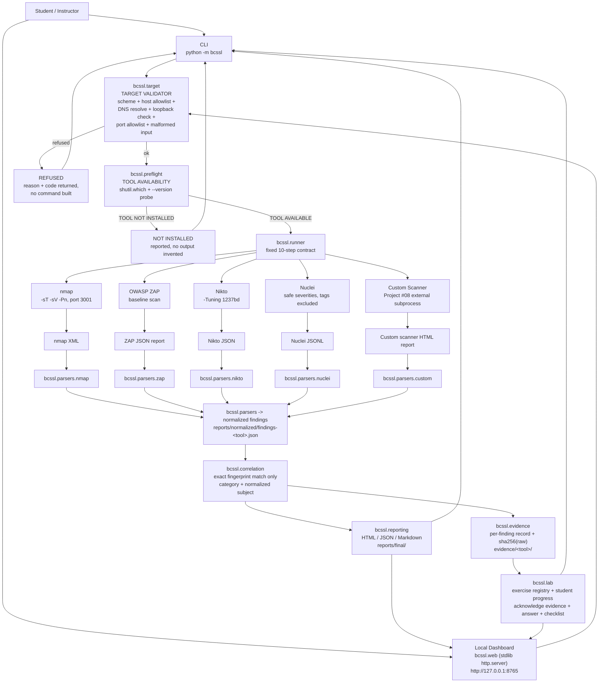
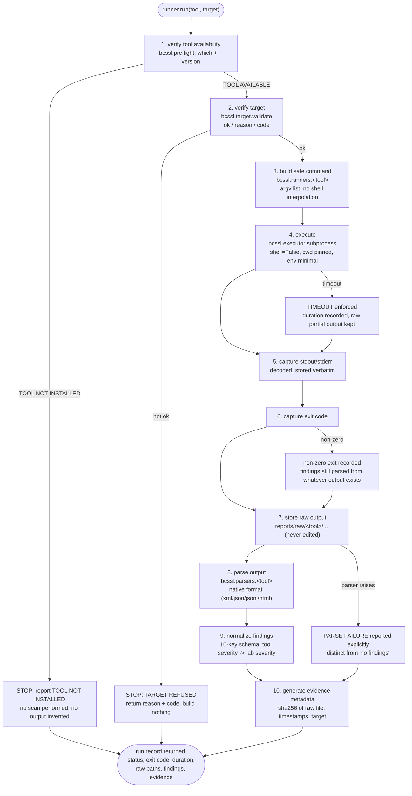

# BCSSL Cybersecurity Assessment Lab - Architecture

## 1. Purpose

BCSSL is a local, classroom-scoped security assessment pipeline. It runs a small set of
well-known assessment tools against a single authorized target - OWASP Juice Shop on
`http://localhost:3001` - normalizes what those tools report into one schema, correlates
findings, records evidence with integrity hashes, and produces a consolidated report.

The lab is deliberately **refusing by default**. It will not construct a command line for
any host that is not loopback, it will not fabricate output when a tool is missing, and it
will not claim multi-tool confirmation for a finding only one tool reported.

## 2. System diagram



## 3. Per-tool runner contract

Every tool invocation goes through `bcssl/runner.py`. The ten steps are fixed and are never
skipped or reordered. A failure at any step is surfaced, never swallowed.



Key properties of the contract:

- Step 1 precedes step 2, so a missing tool never causes a target check to be skipped and a
  refused target never causes a tool to be probed for authorization purposes.
- A non-zero exit code is data, not an exception. Findings that the tool did emit are still
  parsed and kept.
- A parser failure is reported as a parser failure. It is never downgraded to "0 findings".

## 4. Module map

| Module | Responsibility |
| --- | --- |
| `bcssl/config.py` | Loads `config/lab-config.json` and exposes it as the single source of truth for target and tool settings. No defaults that widen the allowlist. |
| `bcssl/target.py` | **TARGET VALIDATOR.** Runs before every tool invocation. Parses the URL, requires `http`/`https`, requires the host to be in the allowlist, resolves the name and rejects any non-loopback address, requires the port to be in the allowed set, rejects malformed input. Returns `{ok, reason, code}`. |
| `bcssl/preflight.py` | **TOOL AVAILABILITY detection.** Probes each configured executable with `shutil.which` plus a `--version` probe. Emits `TOOL AVAILABLE` or `TOOL NOT INSTALLED`. Never fakes a scan. |
| `bcssl/executor.py` | Subprocess execution: captured stdout/stderr, exit code, wall-clock duration, timeout enforcement, no shell interpolation. |
| `bcssl/runner.py` | Base tool runner enforcing the 10-step contract described above. |
| `bcssl/runners/nmap.py` | nmap argv construction and nmap-specific pre/post handling. |
| `bcssl/runners/zap.py` | ZAP baseline-scan invocation and report path handling. |
| `bcssl/runners/nikto.py` | Nikto argv construction including the pinned `-Tuning` set. |
| `bcssl/runners/nuclei.py` | Nuclei argv construction including severity list and excluded tags. |
| `bcssl/runners/custom.py` | Locates the external Project #08 scanner, selects its interpreter and modules, invokes it as a subprocess. Never modifies it. |
| `bcssl/parsers/nmap.py` | Parses nmap XML (`-oX`). |
| `bcssl/parsers/zap.py` | Parses the ZAP JSON report's `alerts` array. |
| `bcssl/parsers/nikto.py` | Parses Nikto JSON output. |
| `bcssl/parsers/nuclei.py` | Parses Nuclei JSONL (one JSON object per line). |
| `bcssl/parsers/custom.py` | Parses the external scanner's HTML report. |
| `bcssl/correlation.py` | Cross-tool correlation on exact normalized fingerprints. |
| `bcssl/evidence.py` | Evidence records: raw excerpt, sha256 of the raw output file, timestamps. |
| `bcssl/reporting.py` | Consolidated HTML / JSON / Markdown report. |
| `bcssl/lab/` | Exercise registry (beginner / intermediate / advanced) and student progress tracking. |
| `bcssl/web/` | Optional local dashboard built only on `http.server` and `json`. No third-party web framework. |
| `bcssl/cli.py` | Command-line entry point and argument surface. |

Top-level directories `runners/`, `parsers/`, and `tools/` are intentionally thin. The
`runners/<tool>-runner/` entry points contain no logic; they import and delegate to
`bcssl.runners.<tool>`. `parsers/<tool>-parser/` are standalone parser CLIs that delegate to
`bcssl.parsers.<tool>`. Per-tool metadata (executable name, Docker image, version probe,
install hints) lives in `tools/<tool>/tool.json`.

## 5. CLI surface

```
python -m bcssl validate-target [--url URL] [--json]
python -m bcssl preflight [--json]
python -m bcssl run <tool> [--url URL] [--timeout N] [--json]
    tool in {nmap, zap, nikto, nuclei, custom-scanner}
    tool-specific flags:
      --modules M              (custom-scanner)
      --mode baseline|passive  (zap)
      --tuning X               (nikto)
      --severities a,b         (nuclei)
      --ports X                (nmap)
python -m bcssl run-all [--tools a,b,c] [--url URL] [--json]
python -m bcssl collect [--json]
python -m bcssl report [--format html|json|md] [--output PATH] [--open]
python -m bcssl status [--json]
python -m bcssl lab list | show <id> | ack <id> --check <cid> --answer <qid>=<text> | progress
python -m bcssl web [--host 127.0.0.1] [--port 8765] [--open]
python -m bcssl version
```

`validate-target` and `preflight` are deliberately separate commands so that a student can
demonstrate that the refusal and the availability checks work *before* running anything.

## 6. Data flow

1. **Request.** A run request names a tool, an optional URL, and optional tool-specific
   flags. If `--url` is omitted, the URL comes from `config/lab-config.json`.
2. **Availability.** `preflight` resolves the executable and probes its version.
3. **Authorization.** `target.validate()` decides whether the URL is in scope.
4. **Command construction.** `bcssl.runners.<tool>` builds an argument vector. No string
   concatenation, no shell.
5. **Execution.** `executor` runs it with a timeout and captures the three outcome channels.
6. **Raw capture.** stdout/stderr are written verbatim under `reports/raw/`.
7. **Parsing.** `bcssl.parsers.<tool>` reads the native output.
8. **Normalization.** Findings are emitted in the ten-key schema.
9. **Correlation.** `correlation.py` groups findings by exact fingerprint.
10. **Evidence and reporting.** `evidence.py` writes records and hashes; `reporting.py`
    renders the consolidated report to `reports/final/`.

## 7. Normalized finding schema

Every normalized finding has exactly these ten keys:

```json
{
  "tool": "nuclei",
  "category": "missing-security-header",
  "severity": "MEDIUM",
  "title": "Missing security header",
  "description": "As reported by the tool, preserved in the tool's own words where possible.",
  "target": "http://localhost:3001",
  "endpoint": "http://localhost:3001/rest/products",
  "evidence": "exact excerpt from the raw tool output",
  "recommendation": "as reported by the tool, or omitted-as-empty if the tool gave none",
  "timestamp": "2026-01-01T00:00:00Z"
}
```

Severity vocabulary after normalization: `CRITICAL`, `HIGH`, `MEDIUM`, `LOW`, `INFO`.

**Findings are never invented.** A parser emits a finding only when the tool actually
reported the corresponding item. An empty result is reported as an empty result, and a
parser error is reported as a parser error. The two are never conflated.

Severity mapping per source tool is documented in `docs/tool-guide.md`.

## 8. Correlation rules

- Correlation keys are **exact** normalized fingerprints: the pair
  `(category, normalized subject)`. "Normalized subject" means the endpoint or target after
  canonical host/port/case normalization. There is no fuzzy or substring matching.
- Two or more tools reporting the same fingerprint produce
  `Confirmed by multiple tools`, and the report lists each contributing tool by name.
- A fingerprint reported by exactly one tool produces `Single-tool observation`.
- The report never claims multi-tool confirmation for a finding that only one tool
  reported. If a tool reported it once and another tool reported a *different* category,
  those remain two single-tool observations.

## 9. Safety invariants

These are enforced in code, not by convention.

1. **Single authorized target.** Only `http://localhost:3001` is in scope by default. The
   target validator rejects everything else.
2. **Loopback only.** The host must be in the configured allowlist (`localhost`, `127.0.0.1`,
   `::1`) **and** must resolve exclusively to loopback addresses. A hostname that resolves
   to a routable address is refused even if the name looks harmless.
3. **Port allowlist.** The port must be in the configured set; default is `3001` only.
   Widening it is an instructor action and is still loopback-only.
4. **Scheme restriction.** Only `http` and `https`.
5. **No shell interpolation.** Commands are argument vectors executed with shell
   disabled, so no user-supplied value can become a second command.
6. **Refusal is a feature.** A refusal returns a reason and a machine-readable code and stops
   the pipeline before any command is built. Nothing is scanned and nothing is recorded as if
   it had been.
7. **No fabrication.** Missing tool means `TOOL NOT INSTALLED`. Empty parser output means
   zero findings. Parser failure means parser failure. These three states are always
   distinguishable in the output and in the report.
8. **Non-destructive scope by construction.** Each tool is invoked with an explicitly
   restricted configuration: nmap TCP connect scan on the authorized port only; ZAP in
   baseline mode; Nikto with a tuning set that excludes injection, file retrieval, DoS,
   command execution, SQL injection, authentication bypass, and RFI plugins; Nuclei with
   safe severities only and with `dos`, `fuzz`, `intrusion`, `headless`, `bruteforce`,
   `brutespray`, and `code` tags excluded, rate-limited. See `docs/tool-guide.md`.
9. **Raw output is immutable.** Everything under `reports/raw/` is stored verbatim and
   hashed. The lab never edits raw tool output.
10. **Progress is not inferred from runs.** A tool run does not complete an exercise.
    Progress requires acknowledged evidence, answered questions, and a ticked checklist
    item, all recorded by the student.

## 10. Directory layout

```
BCSSL-Cybersecurity-Assessment-Lab/
  README.md, LICENSE, .gitignore, pyproject.toml
  config/lab-config.json            <- single source of truth for target + tool config
  bcssl/                            <- engine package (config, target, preflight, executor,
                                       runner, parsers, runners, correlation, evidence,
                                       reporting, lab, web, cli)
  runners/{nmap,zap,nikto,nuclei,custom-scanner}-runner/   <- thin delegates to bcssl.runners
  parsers/{nmap,zap,nikto,nuclei,custom}-parser/           <- standalone parser CLIs
  tools/{nmap,zap,nikto,nuclei,custom-scanner}/tool.json   <- exec name, image, probe, hints
  reports/raw/                      <- verbatim tool stdout/stderr + native tool reports
  reports/normalized/               <- findings-<tool>.json (normalized schema)
  reports/final/                    <- consolidated report (html/json/md)
  evidence/<tool>/                  <- per-finding evidence records + sha256 of raw output
  state/                            <- student progress + run index (gitignored)
  lab/{beginner,intermediate,advanced}/exNN/{exercise.json,exercise.md}
  scripts/                          <- preflight.py, validate-target.py, run-all.py,
                                       collect-results.py, generate-report.py
  docs/                             <- these six files
  tests/                            <- pytest suite
```

## 11. State and data ownership

- `config/lab-config.json` is read-only at runtime. The lab never writes to it.
- `reports/raw/` is append-only from the lab's perspective; each run writes a new timestamped
  artifact rather than overwriting.
- `reports/normalized/` is derived data. It can be regenerated with `collect` or `report`
  from `reports/raw/` at any time.
- `reports/final/` is fully derived and can be deleted and rebuilt.
- `state/` holds the run index and student progress. It is gitignored because it is
  per-student, not part of the deliverable.